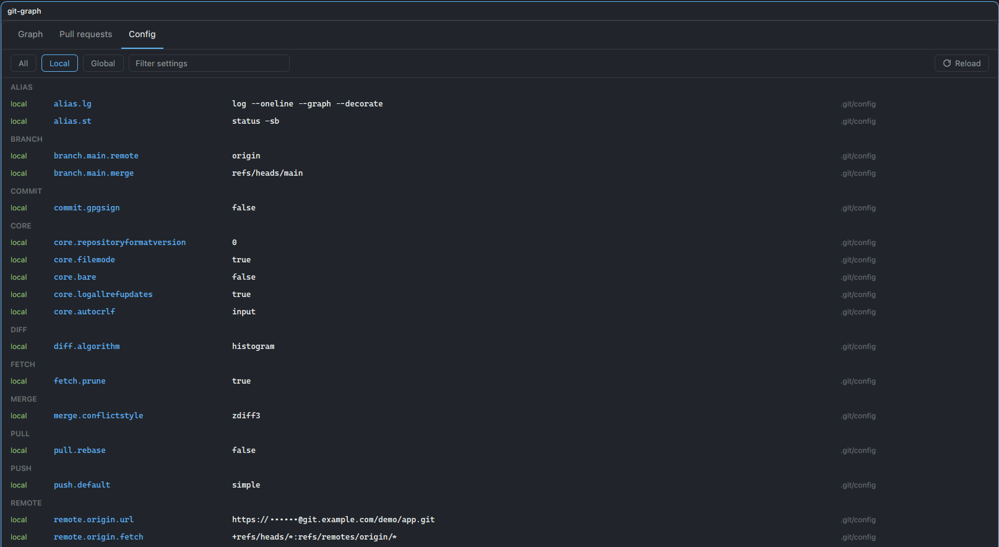
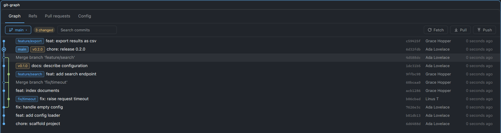

# herdr-mods

A collection of mods for the [Herdr](https://herdr.dev) desktop app. Each mod lives in its own folder and follows Herdr's sharing layout, so it can be installed by copying `mods/<name>/` into your Herdr config home.

| Mod | Description | Default key |
| --- | --- | --- |
| [git-panel](git-panel/) | Commit graph, branches, tags and stashes, everyday git operations, a GitHub pull-request browser and a git config view | `ctrl-shift-g` |

## git-panel

A repository overlay with four tabs. (It was called `git-graph` until it grew past the graph. If you installed that: delete `~/.config/herdr-app/mods/git-graph/` and change `mod.open:git-graph` to `mod.open:git-panel` in your `keys.json` and in any saved tab or layout that uses `--mod git-graph`.)

**Graph**
- Lane-based commit graph with ref chips, author and relative time, rendered in a virtual list.
- Branch menu: filter, switch, track a remote branch, or create a new one.
- Fetch, Pull (`--ff-only`) and Push with ahead/behind indicators. Push asks for a second click and never forces. A branch that never had an upstream is published with `push -u origin HEAD`; one whose upstream was deleted on the remote is not re-published (the mod tells you instead); otherwise it runs a plain `push`.
- Search the loaded commits by subject, author, ref name or hash: non-matches are dimmed, `Enter` and `Shift+Enter` step through the matches.
- Working-tree state: a count of the entries `git status` lists (an untracked folder counts once) and of conflicts beside the branch chip, and a banner while a merge, cherry-pick, revert, rebase or `git am` is in progress.
- Guarded local writes: at a selected commit, create a branch or a tag (annotated with a message) or check it out detached; under Refs > Stashes, stash changes (untracked files included), apply a stash, or pop or drop one (two clicks); under Refs > Branches, rename a branch or delete one that is merged (`-d`, two clicks); at a commit, cherry-pick or revert it onto the current branch (two clicks, clean tracked files, no merge commits); and abort a merge, rebase, cherry-pick or revert that is in progress (two clicks; it discards the work on it so far). Names are validated and nothing else runs during a merge or rebase. There is no reset, discard, force, `branch -D`, `stash clear` or continue/skip. The success note of a delete, pop or drop stays up and shows how to bring the item back. See [ADR-007](docs/decisions/ADR-007-allow-guarded-local-writes.md).
- Commit details with the full hash (Copy), clickable parents, author and committer, changed files, and per-file diffs with intra-line highlighting. A `History` button on a file's diff lists the commits that touched it up to the open commit (renames followed, at most 100); click one to jump to it in the graph.
- A chip beside the branch chip shows the current branch's pull request (number, state, review decision, CI dot); click it to open that PR. It appears only after you have opened the Pull requests tab in that view, meaning the overlay, tab or pane (until then the Graph tab never contacts GitHub); from then on, for every repository that view follows, it asks GitHub through `gh` about once a minute while the Graph tab is selected and wide, and it stays hidden when there is no PR, no `gh`, or `prChip` is `false`.
- Operation status is reported as plain text, including git's own error messages.

**Refs**
- Lists (read-only): local branches (upstream, `↑n`/`↓n`, `gone`, and `merged` when reachable from HEAD), tags (annotated or not), stashes and the reflog (most recent 100). Click a stash to see its files and diff and to apply, pop or drop it; click a branch to rename or delete it.

**Pull requests** (requires [`gh`](https://cli.github.com))
- Open, Merged and Closed lists with CI status, draft state, review decision, branch and author.
- Detail panel with merge state (ready, blocked, behind, conflicts), labels, requested reviewers, checks, reviews, the rendered description and changed files; click a file to see its diff.
- Checkout (`gh pr checkout`), Open in browser, and Close (dismisses the detail panel only). Creating, reviewing, merging and closing PRs on GitHub are intentionally out of scope.

**Config**
- Read-only list of the effective git configuration (`git config --list --show-origin --show-scope`), grouped by section, with the scope (local, global, system, ...) and file each setting comes from.
- Filter by scope (All, Local, Global) and by text. Masking is best effort: credentials in URLs (including `url.<base>.insteadOf` keys) and proxy settings, `http.extraHeader`, and values of settings whose name contains `pass`, `token` or `secret` are hidden; other secrets stored under arbitrary keys are not. Editing configuration is intentionally out of scope.



### Requirements

- Herdr desktop app (not the TUI)
- `git`
- `gh`, authenticated, for the Pull requests tab and the pull request chip



### Install

```sh
curl -fsSL https://raw.githubusercontent.com/dhoaibao/herdr-mods/main/install.sh | sh
```

[`install.sh`](install.sh) downloads the repository tarball and copies `git-panel` into your Herdr config home. It refuses to overwrite an existing install. Apart from a temporary download directory, it writes only inside the config home. Read it before piping it to a shell.

Key binding: `keys.json` holds your whole keymap, so the installer never creates one (a file with a single key would replace Herdr's default shortcuts). If you already have one and `ctrl-shift-g` is free, it adds the binding with `jq` after saving a backup next to the file. Herdr treats any edited `keys.json` as yours and stops adding new default shortcuts to it. If `jq` is missing, the key is taken, there is no file, or the file is a symlink (dotfiles managers), the installer prints the line to add by hand.

| Option / variable | Effect |
| --- | --- |
| `sh -s -- --force` | Replace an existing install; the old copy moves to `<home>/backups/` |
| `sh -s -- --no-keys` | Leave `keys.json` alone |
| `HERDR_MODS_REF=<commit>` | Install a specific branch, tag or commit instead of `main` |
| `HERDR_APP_HOME=<dir>` | Use another Herdr config home (default `~/.config/herdr-app`) |
| `HERDR_MODS_SRC=<dir>` | Install from a local checkout of this repo instead of downloading |

Set variables on the `sh` side of the pipe: `curl -fsSL <url> | HERDR_MODS_REF=<commit> sh`. For a fully pinned install, use the same commit in the `install.sh` URL instead of `main`.

Manual install: copy `git-panel/mods/git-panel` to `~/.config/herdr-app/mods/`. If you have a `~/.config/herdr-app/keys.json` (a keys file is yours to merge, never replace), add [`git-panel/keys.json`](git-panel/keys.json) to it:

```json
{ "global": { "ctrl-shift-g": "mod.open:git-panel" } }
```

Herdr hot-reloads mods, so no restart is needed.

### Usage

Press `ctrl-shift-g` to open the overlay on the current folder. To open it as a tab with specific options:

```sh
herdr-app do tab.new --mod git-panel --props '{"folder":"/path/to/repo","tab":"prs","state":"open"}'
```

| Prop | Values | Meaning |
| --- | --- | --- |
| `folder` | path | Repository to show |
| `tab` | `graph`, `refs`, `prs`, `config` | Initial tab |
| `scope` | `all`, `local`, `global` | Initial scope filter of the Config tab |
| `state` | `open`, `merged`, `closed` | Initial pull-request filter |
| `pr` | number | Pull request to open in the detail panel |
| `prChip` | `false` | Never show the current-branch pull request chip on the Graph tab, even after the Pull requests tab was used (the chip is otherwise shown once that tab has been opened, and then asks GitHub through `gh` about once a minute) |

## Security

Herdr mods are unsandboxed JavaScript with the same access as the app. `git-panel` runs these commands in the repository you open it on:

- `git`: `fetch --all --prune` (contacts remotes and removes stale remote-tracking refs), `pull --ff-only`, `push`, `switch` (including `--track`, `-c` and `--detach`), `branch <name> <hash>`, `tag` (lightweight, or `-a -m` with a message), `stash push --include-untracked`, `stash apply <hash>`, `stash pop stash@{n}`, `stash drop stash@{n}`, `branch -m`, `branch -d` (never `-D`), `cherry-pick <hash>`, `revert --no-edit <hash>`, `merge`/`rebase`/`cherry-pick`/`revert` with `--abort`, and read-only queries (`log` (including `--follow` for a file's history), `show`, `status --porcelain=v2`, `for-each-ref` (including `--merged HEAD`), `stash list`, `reflog`, `rev-list`, `rev-parse` (including `--git-path`, to detect a merge, rebase, cherry-pick, revert or patch in progress, including before an Abort, and `--verify` before a stash pop, drop or branch delete), `check-ref-format` (before a branch or tag is created or renamed), `status --porcelain --untracked-files=no` (before a cherry-pick or revert), `symbolic-ref`, `config --get`, `config --list --show-origin --show-scope -z` for the Config tab).
- `gh`: `pr list`, `pr view` (with a number for the detail panel; without one, about once a minute while the Graph tab is selected and wide, and only after the Pull requests tab was opened in that view, for the current branch's chip), `pr diff` (read-only, contact GitHub), `pr checkout` (may fetch from a fork and add a remote) and `pr view --web` (opens your browser).

It never creates, merges, reviews or closes pull requests, never forces a push, and never runs `reset`, `clean`, `restore`, a `rebase` or `merge` of its own, `branch -D` or `stash clear`. Review the source before installing.

## Development

The running app loads `~/.config/herdr-app/mods/<name>/`; this repository holds the source of truth for sharing. Mirror changes between the two.

```sh
bun install                                       # dev tooling only (mods have no dependencies); also installs the git pre-commit hook
herdr-app check git-panel/mods/git-panel          # renders the initial state; also writes the .d.ts files
bun run check                                     # eslint, prettier --check, shellcheck, tsc
bun run format                                    # apply Prettier
```

`bun run typecheck` reads the type declarations Herdr writes into the mod folder (`gpui-kit.d.ts`, git-ignored; it declares `gpui-kit`, `gpui-base` and `herdr`), so run `herdr-app check` once first. The pre-commit hook (Husky, `.husky/pre-commit`) runs the same checks and skips `typecheck` or `shellcheck` with a warning when their prerequisite is missing; `bun run check` itself fails in that case. The hook checks the working tree, not only what is staged. Bypass it with `git commit --no-verify` or `HUSKY=0`; a git client that cannot find `bun` (exit 127) needs bun on its PATH, for example via `~/.config/husky/init.sh`. The mods run in Herdr's own runtime, so ESLint assumes no Node or browser globals.

`herdr-app check` does not exercise click handlers or later UI states, so test those in the app. See [`git-panel/RECIPE.md`](git-panel/RECIPE.md) for the build brief and known gpui-kit limitations, and [`AGENTS.md`](AGENTS.md) for contributor and agent guidance.
