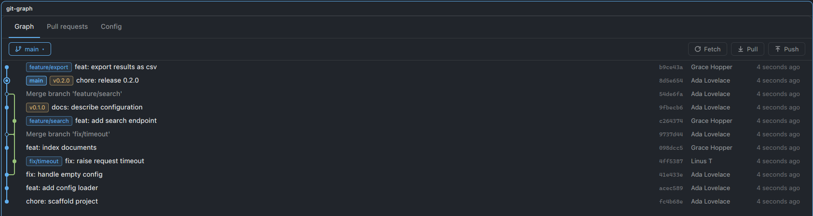

# git-graph

A repository overlay for the Herdr desktop app: a colored commit graph with everyday git buttons, a GitHub pull-request browser and a read-only view of the git configuration. `ctrl-shift-g` opens it on the repo of the focused terminal; click a commit to read its message and diff, click a pull request to see its checks, reviews and files.

## What you see

An overlay, 1200 × 900 (`mod.json`: `{ "place": "none", "overlay": { "width": 1200, "height": 900 } }`), with a 10 px rounded frame, a 1 px border and the theme background. Every color is a theme token (`accent`, `ansi1`–`ansi6`, `ansi10`, `muted`, `dim`, `border`, `hover`, `selected`, `raised`, `popover`); nothing is hard-coded. Monospace text uses the theme's mono font.

Top to bottom:

1. **Tabs row**, 46 px: `Graph`, `Pull requests` and `Config`, 14 px text, a 2 px accent underline under the active one. No title.
2. **Controls row**, 46 px, per tab.
   - Graph: a branch chip (accent border, branch icon, name truncated at 220 px, `▾`), then `↓n` (ansi3) and `↑n` (ansi2) behind/ahead as 20 px tinted pills, and on the right the buttons `Fetch`, `Pull`, `Push`. Buttons are 28 px high, 12 px side padding, 6 px radius, 1 px border, 13 px text, each with a 14 px icon in the button's text color (`fetch.svg`, `pull.svg`, `push.svg`, `branch.svg`).
   - Pull requests: three filter buttons `Open`, `Merged`, `Closed` (the active one has an accent border) and a `Reload` button with the fetch icon.
   - Config: scope buttons `All`, `Local`, `Global` (the active one has an accent border), a 260 px bordered filter input and a `Reload` button.
3. **Note bar**, only while an operation runs or has a result: at least 30 px high, plain text. Running is muted on a `raised` background with an accent bar on its left edge, success is ansi2 (`Fetch: done`, cleared after 5 s) and failure is ansi1, each on a 14-alpha tint of its color with a 3 px bar of that color on the left; a failure holds the last four lines of git's or gh's message. No spinner and no check icon.
4. **Body.** When a list has nothing to show, its message (`Loading history…`, `No commits`, `No open pull requests`, `Not a git repository`, an error in ansi1) is centered over the list area, in `dim`.
   - Graph: a list of 28 px rows. Left, a lane column 16 px per lane (at most 10 lanes) wide: 2 px vertical lane lines in a palette cycling `accent, ansi2, ansi3, ansi5, ansi6, ansi1, ansi4, ansi10`, rounded bends where a lane joins or branches off, and an 8 px node (filled; a merge commit's node is hollow with the lane color as border; the checked-out commit gets a 14 px accent ring around a filled core). Then ref chips (20 px high, 12 px text, tinted fill plus border in the chip color: current branch accent, filled stronger and semibold; tag ansi3, remote branch ansi4, local branch ansi2; at most three, a `+n` in `dim` counts the rest), the commit subject (muted for merge commits), the short hash (60 px, mono, dim), the author (130 px, muted) and the relative time (105 px, dim). The selected row has a 2 px accent bar on its left edge. Under 560 px width the hash and author columns are dropped and the time becomes the 7-character hash.
   - Pull requests: a list of 32 px rows: an 8 px CI dot (ansi1 fail, ansi3 pending, ansi2 pass, border color when there are no checks), `#number` (52 px, dim), the title, a branch chip (ansi4, up to 260 px), the author (120 px, wide layout only) and the age (90 px, dim).
   - Config: 28 px rows grouped by section. A heading row (12 px, uppercase, `dim`) starts each section; a setting row shows the scope (62 px, colored: local ansi2, global ansi4, system ansi5, worktree ansi6, command ansi3), the key (mono, accent, 280 px; 180 px in the narrow layout), the value (mono, flexible, `(no value)` when empty) and, in the wide layout, the file it came from (240 px, dim). A 34 px footer reads `N settings · read-only; later scopes override earlier ones`.
5. **Detail panel** below the list, only after a selection.
   - Commit: 340 px high, a 40 px header (accent short hash, `N files changed`, total `+n` ansi2 and `−n` ansi1), the message (first 60 lines: the subject at 15 px semibold, a `dim` 12 px `author · date` line, then the body in muted text) and a list of changed files (28 px mono rows: a tinted 18 px status badge A ansi2 / D ansi1 / other ansi3, the path with its directory in `dim` and the file name in the text color, `+n` ansi2, `−n` ansi1).
   - Pull request: 440 px high, a 40 px header with `#number`, the title and the buttons `Checkout`, `Open in browser`, `Close`. Wide layout: two columns, the left (info) flexible and the right (`FILES (n)`) 440 px with a left border. Narrow layout: the same two blocks stacked, each half of the height. The info column has the title (15 px semibold), the state chip (`Draft` muted, `Merged` ansi5, `Closed` ansi1, `Open` ansi2), `head → base`, `+additions −deletions N files`, a CHECKS list (8 px state dot, name, state; `fail` in ansi1 and `pending` in ansi3, the rest `dim`), a REVIEWS list (author, state in ansi2 for approved and ansi1 for changes requested) and the description rendered as markdown.
   - A clicked file replaces the panel body with its diff: 22 px rows, two 44 px line-number gutters, an 18 px `+`/`−` column, added lines on an ansi2 tint and removed lines on an ansi1 tint (the color at alpha `30`), hunk headers on a `raised` row with the range in accent, and the changed words inside a changed line highlighted. A `‹ Files` button (commit) or `‹ Details` button (PR) in the header returns to the list.
6. **Footer**, Graph only, 44 px, when more history exists: `Showing N commits` and a `Load more` button (adds 400).
7. **Branch menu**: a 380 px popover at (14, 50) with a filter input and 28 px rows, up to 380 px high. Rows show `●` and a faint accent background for the current branch (semibold), a small `remote` pill in ansi4 for remote-only branches, and a first row `Create branch "<typed>"` in accent when the typed name is valid and does not exist.

## How it behaves

- **Which repo.** `props.folder` pins it to one folder. Otherwise it follows the focused pane (its cwd, or the space folder; on a remote machine it runs there). It shows `Not a git repository` when there is none, `No commits yet` for an empty repo and `Loading history…` while reading.
- **Opening.** `mod.open:git-graph` toggles the overlay (pressing the key again closes it). A tab or pane works too: `herdr-app do tab.new --mod git-graph --props '{"folder":"/repo","tab":"prs","state":"merged","pr":8}'`. Props: `folder` (path), `tab` (`graph` | `prs` | `config`; default is the tab last used), `state` (`open` | `merged` | `closed`), `pr` (a positive integer, preselects that PR), `scope` (`all` | `local` | `global`; the Config tab's scope filter, default `all`). The last graph read for each folder is kept at module scope, so reopening paints at once and refreshes in the background.
- **Refresh.** Every 5 s, and when a watched folder changes (local repos). The graph is re-read only when the refs, HEAD, branch, ahead/behind or limit changed. The PR list is re-read at most once a minute unless a filter changes.
- **Graph reads** use `git log --branches --remotes --tags HEAD --date-order -n 400` plus `for-each-ref`, `rev-parse`, `symbolic-ref`, `rev-list --left-right --count @{upstream}...HEAD` and `config --get branch.<name>.merge`, all read-only (`--no-optional-locks`, `core.fsmonitor=false`).
- **Clicking a commit** loads its message and changed files; clicking the same commit again closes the panel. Clicking a file shows that commit's diff for the file; a merge commit shows the diff against its first parent.
- **Fetch** runs `git fetch --all --prune`. **Pull** runs `git pull --ff-only` and is disabled on a detached HEAD. The label becomes `Pull ↓n` when behind.
- **Push** needs two clicks: the first turns the button into `Click again to push ↑n` with an ansi1 border for 5 s, the second runs it. It never forces. A branch that never had an upstream runs `git push -u origin HEAD`; a branch whose upstream was set but no longer exists on the remote is refused with a note instead of being re-published. A detached HEAD shows `Detached HEAD: switch to a branch to push`.
- **Branch menu.** Click the chip, type to filter. A local branch runs `git switch <name>`, a remote-only one `git switch --track <remote/name>`, the create row `git switch -c <name>`. New names must match `^[A-Za-z0-9_][A-Za-z0-9._/-]*$`, contain no `..`, and not end in `/` or `.lock`. Branch names that start with `-` are never listed.
- **One operation at a time.** While one runs the others are ignored. When it ends the graph is re-read.
- **Menu click-through.** There is no occlusion in gpui-kit, so clicks that dismiss or pick from the menu would also hit what is under it; the view ignores clicks while the menu is open and for 400 ms after it closes.
- **Pull requests** (needs `gh`): `gh pr list --state <open|merged|closed> --limit 50 --json …` in gh's default order (the age column shows the last update); an empty list reads `No <state> pull requests`. `Reload` re-reads it. Clicking a row loads `gh pr view <n> --json …` and `gh pr diff <n>`; clicking the row again closes the panel. `Checkout` runs `gh pr checkout <n>` (one click, a local branch switch). `Open in browser` runs `gh pr view <n> --web` and is hidden for a repo on a remote machine. `Close` only closes the panel; the mod never closes, merges, reviews or creates a PR on GitHub.
- **Config** (`config.js`): `git config --list --show-origin --show-scope -z`, read on opening the tab and on every refresh while it shows; the view repaints only when the output changed. Entries are sorted by section and keep git's order inside one, so a key set in several scopes appears once per scope and the later one wins. The filter matches key, value and file. Masking is best effort and applies to keys and values: a setting is shown as `••••••` when its name (the part after the last dot) contains `pass`, `token`, `secret` or `extraheader`; a URL's `user:password@` or long token before `@` becomes `••••••@` (a plain `git@` stays), including inside keys such as `url.<base>.insteadOf`; a `proxy` value's `user:password@` is masked even without a scheme; an assignment whose name contains `pass`, `token` or `secret` (`password=…`, `GH_TOKEN=…`, `client_secret='…'`, as in an inline credential helper) keeps its name and quote and has its value replaced by `••••••`. The filter runs on the masked text. The tab never writes configuration. It shows `Not a git repository` outside a repo.
- **Errors** from git or gh show as text in the note bar, or in the list area when the list itself fails.

## Built from

- `main.js`, default-exporting a class that extends `View` (`init(props, cx)`, `render`), from `gpui-kit` (`View`, `div`, `svg`) and `gpui-base` (`v_flex`, `h_flex`, `InputState`, `Input`, `Scrollbar`, `v_virtual_list`, `TextView` in `prs.js`).
- `config.js`, the Config tab: parsing and masking (`parseConfig`, `maskKey`, `maskValue`), the toolbar, the virtual list `gg-cfg` (28 px). It takes the view as `v` and keeps its state under `cfg*` names.
- `prs.js`, the Pull requests tab: list rows, detail panel, `gh` calls. It takes the view as `v` and keeps its state on it under `pr*` names.
- `herdr` functions: `spaces`, `panes`, `focused` (where the focused terminal is), `exec` (every git and gh call, argv array, no shell, `cwd` set to the repo root), `watchFolder`, `theme`, `settings`, `props`.
- Virtual lists with `on_item_click` on the list: `gg-list` (commits, 28 px), `gg-prs` (PRs, 32 px), `gg-branches` (menu, 28 px), `gg-diff` (22 px).
- Icons: `branch.svg`, `fetch.svg`, `pull.svg`, `push.svg`, `more.svg`, drawn in the button's text color.
- Programs run: `git` and, for the Pull requests tab, `gh`.
- Key binding, in `keys.json`: `{ "global": { "ctrl-shift-g": "mod.open:git-graph" } }`.

## Watch out

- No handlers inside a `v_virtual_list` renderer: put them on the list (`on_item_click`).
- No `occlude`: see the menu click-through rule above.
- Children of a scrolling column need `flex_none`, or wrapped lines overlap. Give every panel a fixed pixel height or the scroll columns spill out.
- Never reuse a `cx` after an `await`; use the one the async callback receives. `cx.timer` exists on async contexts.
- `mod.open` is a toggle: it closes an already open overlay.
- `herdr-app check <mod folder>` only renders the initial state, so handlers and later states are never exercised by it. Take a picture with `herdr-app shot file.png` after opening a temporary tab with `tab.new --mod git-graph --props …`, then close it with `tab.close --id <tab> --confirmed true`.
- A throwaway demo repo is best for screenshots (the preview was taken on one with fake authors); the Herdr sidebar shows workspace names, so crop to the overlay.
- Do not add a spinner or check-mark state to the note bar; status is plain text on purpose.
- The Pull requests tab is read-only on GitHub by design: no create, review, merge or close.
- The Config tab is read-only by design and masks credentials; do not add editing or show raw URL credentials without the user asking.
- Push never uses force and never re-publishes a branch whose remote was deleted; keep both.

## Done when

- `herdr-app check git-graph/mods/git-graph` prints `check passed` and `node --check` passes for `main.js` and `prs.js`.
- Opening the overlay on a repo with branches and merges shows the graph with colored lanes, ref chips, authors and relative times, and the branch chip shows the current branch.
- `Fetch`, `Pull` and `Push` show `↓n` and `↑n` when the branch is behind or ahead, and `Push` needs a second click within 5 s.
- In a repo whose branch had its upstream deleted on the remote, `Push` shows the refusal note and runs nothing.
- Clicking a commit shows its message and files; clicking a file shows a diff with two gutters and highlighted changed words.
- On the Pull requests tab, `Open`, `Merged` and `Closed` list up to 50 PRs, a row opens the detail panel with checks, reviews, the markdown description and files, and a file opens its diff.
- `Checkout` switches to the PR's branch, `Open in browser` opens the PR page, and `Close` only closes the panel.
- On the Config tab, settings are grouped by section with their scope and file, `Local` and `Global` narrow the list, the filter matches key, value and file, and a remote URL with `user:token@` and a `url.<base>.insteadOf` key with a token show `••••••@`, and `sendemail.smtppass` and `http.extraHeader` show `••••••`.
- With `{"pr":8}` and `{"tab":"prs"}` in the props the PR tab opens with PR 8 selected; `{"pr":-5}` or `{"pr":"8a"}` select nothing.
